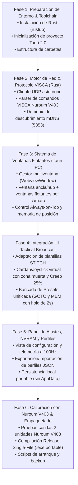

# Plan de Trabajo: NDI PTZ Joystick Controller (Tauri + Rust)

> [!IMPORTANT]
> **Enfoque Tecnológico:** Tauri 2.0 (Backend en Rust + Frontend HTML/Tailwind) para garantizar un ejecutable único portable de ~15 MB sin dependencias en el equipo de destino.
> **Hardware de referencia:** 2 unidades **Nuroum V403 PTZ** (control por VISCA-over-IP en UDP y autodescubrimiento mDNS en puerto 5353).
> **Alcance:** Control cinemático PTZ, telemetría y ventanas flotantes independientes. Las aplicaciones de captura de vídeo se desarrollarán por separado en fases posteriores.

---

## 1. Diagrama de Flujo del Plan de Desarrollo

---

## 2. Desglose Detallado de Fases y Tareas

### Fase 1: Preparación del Entorno & Inicialización del Proyecto
- [x] **Instalación de la cadena de compilación de Rust:**
  - Instalado `rustup` y el toolchain nativo `stable-x86_64-pc-windows-gnu`.
  - Instaladas herramientas GNU Binutils (`dlltool`, `gcc`, `ld`) mediante WinLibs.
  - Verificación exitosa de compilador y enlazador en Windows.
- [x] **Scaffolding de Tauri 2.0:**
  - Inicializada la estructura base en `src-tauri` con soporte multiventana y arquitectura desacoplada.
  - Configurado `tauri.conf.json` con permisos y dimensiones para consola táctica.
  - Iconos tácticos generados en `src-tauri/icons/` (`icon.ico`, `icon.png`, `32x32.png`, `128x128.png`).
  - Resolución del bug de espacios en MinGW/windres mediante mapeo virtual transparente en `arrancar.bat`.
  - Verificación y compilación de dependencias superada al 100% en `cargo check`.

### Fase 2: Motor de Red en Rust (VISCA-over-IP & Demonio mDNS)
- [x] **Demonio de Descubrimiento (mDNS / DNS-SD):**
  - Implementada escucha continua en puerto `UDP 5353` con `mdns-sd` (`_ndi._tcp.local`, `_ndi-hx._tcp.local`, `_visca._udp.local`) sin NewTek ni Bonjour externos.
  - Registro dinámico `CameraRegistry` en memoria con eventos en tiempo real hacia la UI (`camera-discovered`).
  - Mecanismo de asignación y persistencia manual de IP para subredes con multicast filtrado (preconfiguradas las 2 Nuroum V403 en `192.168.1.141` y `.142`).
  - Detección de presencia/latencia asíncrona (*ping/keep-alive*) con cálculo de RTT en milisegundos.
- [x] **Módulo VISCA-over-IP para Nuroum V403 (Crate `grafton-visca` & Tokio UDP):**
  - Transporte asíncrono Tokio sobre `UDP 1259` con conexión directa dedicada por cámara sin bloqueos ni contención.
  - **Pan / Tilt:** Movimiento con vector $(X, Y)$ normalizado, zona muerta (deadzone 5%), curva exponencial $\gamma = 2.0$ y parada instantánea (`send_ptz_stop`).
  - **Zoom:** Zoom Tele / Zoom Wide con velocidad proporcional (0..=7) y parada instantánea.
  - **Presets:** Recall (`0x02`), Store (`0x01`) y Clear (`0x00`) directos para 8+ presets hacia la NVRAM del dispositivo.
  - **Enfoque / Focus:** Modos Auto, Manual, Far, Near, Stop y OnePushTrigger.
  - **Inquiry de Posición & Telemetría:** Consulta a alta frecuencia de Pan/Tilt, Zoom y Enfoque decodificando nibbles VISCA a grados y ratios reales.
  - **Suite de Pruebas Unitarias:** 7 pruebas automatizadas (`cargo test --test visca_protocol`) superadas con éxito al 100%.

### Fase 3: Arquitectura Multiventana Flotante (Floating Windows)
- [x] **Gestor de Ventanas Desacopladas (Window Manager en Rust/Tauri):**
  - Implementado gestor `WindowManager` en [`src-tauri/src/window_manager.rs`](file:///d:/Documentos/Antigravity/NDI%20PTZ%20Joystick%20Controller/src-tauri/src/window_manager.rs) con instanciación dinámica `WebviewWindowBuilder`.
  - Canales IPC independientes por cámara (`win-cam-{id}`) con auto-foco y prevención de duplicados.
  - Vista flotante especializada e independiente en [`frontend/floating.html`](file:///d:/Documentos/Antigravity/NDI%20PTZ%20Joystick%20Controller/frontend/floating.html).
- [x] **Comportamiento Táctico de Ventanas en Windows:**
  - Botón de Fijado (*Pin / Always-on-Top*) con indicador visual emisivo cian para flotar sobre OBS Studio.
  - Minimizado y cerrado rápido con persistencia automática de geometría.
  - Integración nativa de Bandeja del Sistema (*System Tray*) en [`src-tauri/src/tray.rs`](file:///d:/Documentos/Antigravity/NDI%20PTZ%20Joystick%20Controller/src-tauri/src/tray.rs) para restaurar el Hub o salir limpiamente.
  - Persistencia de coordenadas multimonitor $(X, Y, W, H)$ y estado `always_on_top` en `window_states.json` portable.

### Fase 4: Implementación de la Interfaz Táctica (Frontend)
- [ ] **Componente Joystick / Cardán Virtual:**
  - Detección táctil y de ratón con límites radiales y deflexión porcentual en tiempo real.
  - Algoritmo de suavizado con **curvas exponenciales (EXPO)**: $V = \text{sign}(D) \cdot |D|^{\gamma} \cdot V_{max}$ ($\gamma \approx 2.0$) con zona muerta configurable (*Deadzone*) y amortiguación física.
  - Tecla de acceso rápido `ESPACIO` para centrado automático inmediato.
  - Selector de velocidad con deslizador continuo y **Modo Creep 25%** para tomas cinematográficas lentas.
- [ ] **Bancada de Macros y Presets:**
  - Cuadrícula unificada de 8 botones GOTO/MEM con respuesta táctil visual (ámbar activo en selección, pulsación sostenida de 2 segundos para memorizar con confirmación en cian).
- [ ] **Pantalla OLED de Telemetría:**
  - Renderizado en alta frecuencia de valores tabulares: Pan ($^\circ$), Tilt ($^\circ$), Zoom ($\times$), Estado de AF y Latencia ($ms$).

### Fase 5: Panel de Ajustes, NVRAM y Configuración Portable
- [ ] **Panel de Configuración de Cámara:**
  - Renombrado de cámara (ej. `CAM-01 Nuroum Escenario`, `CAM-02 Nuroum Público`).
  - Asignación de nombres personalizados a cada uno de los 8 presets (ej. `Batería`, `Voz Ppal`).
  - Botón de sincronización con la NVRAM de la cámara Nuroum V403.
  - Botón táctico de **Re-calibración de Enfoque [ENFOQUE]** y auto-saneamiento silencioso de AutoFocus por red (vía HTTP RPC 8090).
- [ ] **Sistema de Perfiles JSON:**
  - Exportación e importación de archivos de perfil de escena (`.json`).
  - Modo portable: Almacenamiento directo en el directorio del ejecutable si existe `portable.flag`.

### Fase 6: Calibración con Nuroum V403, Pruebas y Empaquetado Final
- [ ] **Pruebas de Campo con las 2 Cámaras Nuroum V403:**
  - Asignación de IPs (ej. `192.168.1.141` y `192.168.1.142`).
  - Verificación de respuesta simultánea sin colisiones ni saturación de red.
  - Calibración de límites máximos y mínimos de Pan/Tilt de las cámaras.
- [ ] **Generación del Ejecutable Portable:**
  - Compilación release con `cargo tauri build --no-bundle` para obtener el `.exe` nativo independiente.
  - Empaquetado portable con sus assets y archivos de configuración base.
  - Creación de script de respaldo `backup.py` y script de mantenimiento preventivo.

---

## 3. Matriz de Riesgos y Mitigaciones

| Riesgo Técnico | Impacto | Mitigación |
| :--- | :--- | :--- |
| **Switches de red con IGMP/Multicast bloqueado** | El demonio mDNS no detecta automáticamente las cámaras. | Implementación obligatoria de escáner IP de subred y botón de asignación manual de IP con persistencia. |
| **Latencia acumulada al mover el joystick rápido** | Saltos de movimiento o retraso en la cámara al saturarse el buffer UDP. | Bucle de tasa fija en Rust (throttle a 50-60 Hz) que descarta paquetes redundantes y envía siempre el último vector activo. |
| **Sobreescritura accidental de presets en directo** | Pérdida de un encuadre crítico durante una producción en vivo. | Sistema de seguridad de doble acción: los botones MEM requieren mantener pulsado 1000 ms con feedback visual rojo intermitente. |
| **Diferencias en dialecto VISCA de Nuroum V403** | Algún comando de foco o preset no responde en la cámara. | Módulo VISCA configurable con opción de modo estándar Sony VISCA y modo PTZOptics/Nuroum extendido. |
