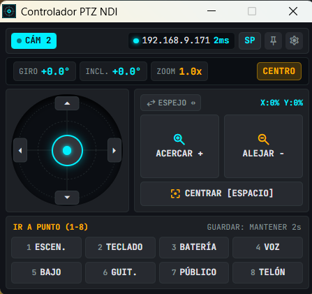
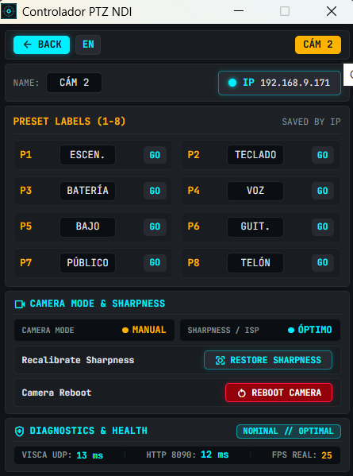

# NDI PTZ Joystick Controller — Tactical Broadcast Suite

> [!CAUTION]
> ### ⚠️ AVISO IMPORTANTE / ARCHIVED & REFERENCE REPOSITORY (AS-IS)
>
> **Este proyecto se publica de forma pública exclusivamente como código de referencia técnica y prueba de concepto para un entorno de hardware específico. No se ofrece soporte técnico ni mantenimiento activo. No se atenderán incidencias (Issues) ni solicitudes de adaptación ni se añadirán nuevas funciones.**
>
> *Notice: This project is published strictly as a technical reference and proof of concept for a specific hardware setup. It is provided "AS-IS" without maintenance, support, or planned updates. Issues and pull requests are not monitored.*

---

## 📋 Descripción del Proyecto

**NDI PTZ Joystick Controller** es una consola de control cinemático y gestión de presets PTZ de grado broadcast para sistemas Windows. Desarrollada sobre **Tauri 2.0 y Rust**, ofrece una interfaz táctica ultraligera y de alta reactividad sin dependencias externas pesadas.

El sistema fue concebido para resolver las particularidades de red y control cinemático de cámaras PTZ basadas en SoCs Rockchip embebidos (**Nuroum V403 / Hamedal Cam V403**), implementando descubrimiento automático y ventanas flotantes desacopladas e independientes para cada unidad conectada.

---

## 📸 Capturas de la Interfaz

| Consola Principal de Control | Panel Unificado de Configuración |
| :---: | :---: |
|  |  |

---

## ✨ Características Principales

* **Arquitectura Multiventana Desacoplada & Diseño Compacto (312 px / 465 px):**
  * **Consola Principal (`index.html`):** Control cinemático, telemetría y selector de cámaras con diseño compacto ajustado verticalmente a 312 px sin franjas vacías.
  * **Ventanas Flotantes Parametrizadas (`floating.html`):** Ventanas individuales e independientes por cámara con fijado *Always-on-Top*, minimizables a la bandeja del sistema (*Tray*).
  * **Panel de Ajustes Unificado (`settings.html`):** Identificación limpia por IP interactiva, validación anti-duplicados de nombres en tiempo real (`¡REPETIDO!`), selector y edición de presets 1-8 en vertical, modo de cámara con botón táctico `[ REHABILITAR NITIDEZ ]`, función de reinicio remoto seguro con cuenta atrás y telemetría de salud en línea única.
* **Control Cinemático & Joystick Virtual:**
  * Control analógico continuo con filtrado de zona muerta (*deadzone*).
  * Modo **Creep Speed** (reducción al 25% para ajustes finos de encuadre).
  * Algoritmo de **Selección de Eje Predominante (*Dominant Axis Selection*)** para resolver limitaciones de hardware en diagonales.
  * Secuencia de **Centrado de Grado Broadcast (STOP preventivo + 40ms + HOME + 40ms redundancia)** para garantizar que la cámara vuelva a su origen incluso durante movimientos continuos rápidos.
* **Bancada de Presets Rápidos:**
  * 8 ranuras de memoria directa por cámara.
  * Modos duales unificados en el propio botón de selección: llamada directa instantánea (**GOTO**) y guardado seguro manteniendo pulsado 2 segundos (**MEM** con confirmación visual táctica).
* **Motor de Red en Rust, Resiliencia y Auto-Saneamiento:**
  * Demonio de autodescubrimiento mDNS / DNS-SD en puerto `UDP 5353` (`mdns-sd`).
  * Mecanismo de contingencia por tabla ARP enfocado en el OUI del fabricante (`98:6E:E8`).
  * Sockets UDP asíncronos no conectados protegidos contra caídas de socket por reinicio de cámara (`WSAECONNRESET` / 10054).
  * Protocolo de reinicio remoto seguro vía API ZLMediaKit/RPC con modal de confirmación y reapertura automática de sockets.
  * Diagnóstico en vivo de latencia de red (`VISCA UDP`), estado de servicio (`HTTP 8090`) y cadencia real normalizada a **25.0 FPS** (PAL 50 Hz).
  * Reaseguramiento automático de `Focus.Mode = "Auto"` vía HTTP JSON-RPC (puerto 8090) en hilo nativo universal desacoplado de runtime.
  * Soporte nativo para escalamiento multi-cámara ($N > 2$) con persistencia independiente por IP.
* **Estabilidad y Ciclo de Vida del Proceso (Windows Job Objects):**
  * Limpieza pre-aplicación en el arranque para eliminar instancias zombi huérfanas antes de inicializar puertos o ventanas.
  * Vinculación del árbol de procesos al kernel de Windows mediante `JobObject` con límite `JOB_OBJECT_LIMIT_KILL_ON_JOB_CLOSE`.
  * Manejo unificado de cierre seguro en eventos `CloseRequested` y en el menú de bandeja (*Tray Quit*).
* **Internacionalización (i18n):**
  * Soporte dinámico multilingüe en caliente sin recompilación: Español e Inglés extensibles a nuevos idiomas mediante edición de fichero plano.

---

## 🔬 Ingeniería Inversa y Particularidades de Hardware (Nuroum V403)

Durante el desarrollo del proyecto se realizó una auditoría completa del firmware y del binario controlador de la cámara Nuroum V403 (`/var/hunter`), documentando peculiaridades fundamentales que hacen indispensable este software de control a medida:

1. **Incompatibilidad de Movimiento Diagonal en Hardware:**
   El desensamblado de la función `CtrlDeviceMotion` reveló que el parser VISCA interno evalúa el byte de *Pan* y, si este es distinto de STOP, bifurca de inmediato hacia el motor horizontal sin procesar jamás la orden de *Tilt*. Cualquier comando diagonal tradicional bloquea el eje vertical. Este controlador lo soluciona aislando en tiempo real el vector preponderante.
2. **Restricción de Polling de Telemetría (UDP 1259):**
   Las consultas cíclicas de coordenadas (`81 09 06 12 FF`) saturan la cola del microcontrolador interno de la cámara, provocando eventos de retorno no deseado al origen (**HOME**). El motor de este proyecto omite el polling destructivo y utiliza un enfoque pasivo/reactivo.
3. **Colisión de Nombres en Flujos NDI:**
   El firmware de fábrica de la cámara anuncia un descriptor duplicado `LOCALHOST (Nuroum Cam V403-)` en todas las unidades. La aplicación diferencia inequívocamente cada cámara mediante su IP y dirección MAC física.
4. **Dependencia de Vídeo Activo para Control Mecánico (Modo Privacidad en Reposo):**
   La cámara incorpora por hardware un modo de ahorro y privacidad (`[privacy] enable = 1` en `config.ini`). Si ninguna aplicación (OBS Studio, NDI Studio Monitor o RTSP) está recibiendo el flujo de imagen de la cámara, los controladores de potencia de los motores paso a paso se desenergizan para evitar sobrecalentamiento. Durante este estado, el firmware sigue respondiendo afirmativamente por red (ACKs VISCA), pero el gimbal permanece mecánicamente bloqueado hasta que se abre el flujo de vídeo (*Wake on Stream*).

> 📖 **Para un análisis técnico en profundidad y guías operativas:**
> * [`DOCUMENTACION.md`](DOCUMENTACION.md): Arquitectura de red, comunicación VISCA-over-IP y multiventana.
> * [`DOCUMENTACION_NUROUM_V403.md`](DOCUMENTACION_NUROUM_V403.md): Auditoría completa de firmware e ingeniería inversa de hardware.
> * [`GUIA_COMPILACION_NATIVA_TAURI_RUST.md`](GUIA_COMPILACION_NATIVA_TAURI_RUST.md): Guía maestra del sistema de compilación portable ultraligero con Rust y Tauri v2.
> * [`GUIA_CONTEXTO_PROBLEMAS_ENTORNO_Y_BACKUP.md`](GUIA_CONTEXTO_PROBLEMAS_ENTORNO_Y_BACKUP.md): Diagnóstico de entornos Windows y arquitectura del script de resguardo `backup.py`.
> * [`Guia_Inicio_Nuevos_Proyectos.md`](Guia_Inicio_Nuevos_Proyectos.md): Requerimientos y estándares de estructura de proyectos.

---

## 📁 Estructura del Repositorio

```text
├── docs/                         # Capturas de pantalla y recursos visuales
├── frontend/                     # Interfaz de usuario táctica (HTML5, Tailwind CSS, JS)
│   ├── index.html                # Consola central / Hub monitor
│   ├── floating.html             # Ventana flotante desacoplada de control PTZ
│   ├── settings.html             # Panel de ajustes y configuración de cámara
│   ├── i18n.js                   # Motor de traducción multilingüe
│   └── ndi_ptz_client.js         # Cliente de comunicación IPC / Mock
│
├── src-tauri/                    # Núcleo de la aplicación en Rust (Tauri 2.0)
│   ├── Cargo.toml                # Definición de paquetes y dependencias Rust
│   ├── tauri.conf.json           # Configuración de ventanas, permisos y seguridad Tauri
│   ├── src/
│   │   ├── main.rs / lib.rs      # Puntos de entrada del runtime
│   │   ├── commands.rs           # Comandos Tauri IPC invocados desde la UI
│   │   ├── camera_rpc.rs         # Cliente RPC/HTTP ligero para ZLMediaKit y telemetría
│   │   ├── discovery.rs          # Demonio mDNS y escaneo de presencia ARP
│   │   ├── models.rs             # Modelos de datos de cámaras y eventos
│   │   ├── process_cleanup.rs    # Control de procesos Windows Job Objects anti-zombies
│   │   ├── tray.rs               # Gestión de la bandeja del sistema (System Tray)
│   │   ├── window_manager.rs     # Orquestación de ventanas flotantes independientes
│   │   └── visca/
│   │       ├── mod.rs
│   │       └── client.rs         # Motor asíncrono VISCA-over-IP (UDP resiliente)
│   └── tests/
│       └── visca_protocol.rs     # Suite de pruebas unitarias del protocolo
│
├── arrancar.bat                  # Script lanzador en modo desarrollo
├── compilar_y_empaquetar.bat     # Generador del paquete binario portable Release
├── backup.py                     # Script de copia de seguridad integral
├── DOCUMENTACION.md              # Documentación técnica de arquitectura
├── DOCUMENTACION_NUROUM_V403.md  # Informe de ingeniería inversa de firmware
├── GUIA_COMPILACION_NATIVA_TAURI_RUST.md       # Guía de empaquetado nativo portable
├── GUIA_CONTEXTO_PROBLEMAS_ENTORNO_Y_BACKUP.md # Diagnóstico de entornos y respaldos
├── Guia_Inicio_Nuevos_Proyectos.md             # Buenas prácticas y arquitectura de proyectos
└── LICENSE                       # Licencia MIT
```

---

## 🛠️ Requisitos de Compilación

* **Sistema Operativo:** Windows 10 / 11 (64-bit).
* **Compilador Rust:** Toolchain estable `x86_64-pc-windows-msvc` o `x86_64-pc-windows-gnu` instalado con `rustup`.
* **Runtime WebView2:** Preinstalado en Windows 10/11 (o instalable mediante el instalador oficial de Microsoft).
* **Node.js (Opcional):** Únicamente necesario si se desea utilizar utilidades de formateo o CLI de Vite/Tauri vía npm.

---

## 🚀 Compilación y Ejecución

### Modo Desarrollo
Para iniciar la aplicación en modo desarrollo con recarga y depuración:
```cmd
arrancar.bat
```
*(El script mapea temporalmente una unidad virtual si es necesario para evitar problemas con rutas con espacios en compiladores MinGW).*

### Compilación de Paquete Portable Release
Para compilar un binario ejecutable optimizado de un solo archivo:
```cmd
compilar_y_empaquetar.bat
```
El ejecutable resultante `NDI-PTZ-Controller.exe` junto con `WebView2Loader.dll` se generará en la carpeta `dist_portable/`.

---

## 📄 Licencia

Este proyecto está bajo la Licencia **MIT**. Consulta el archivo [`LICENSE`](LICENSE) para más detalles.

Copyright (c) 2026 **Vicente Gisbert**.
